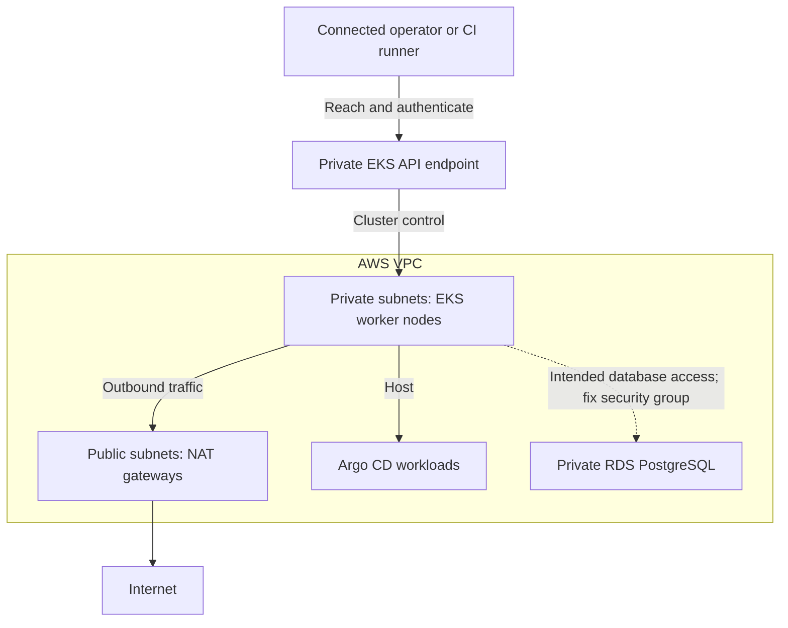

# Cloud Infrastructure Generator: From Architecture to Terraform

Use CrftInfrai to design cloud infrastructure, estimate costs, and generate Terraform for review. This guide uses an **AWS EKS + PostgreSQL RDS + Argo CD** architecture to connect the hosted design workflow with a concrete public Terraform example.

[Open the Cloud Infrastructure Builder](https://console.crftinfrai.com/cloud-infrastructure-builder) · [Compare Cloud Costs](https://console.crftinfrai.com/compare) · [Browse the EKS Template](../templates/eks-rds-argocd/v1/)

## What This Guide Covers

- Choosing an architecture for Kubernetes applications with PostgreSQL.
- Designing infrastructure and reviewing exported Terraform.
- Understanding the resources and costs in the public AWS example.
- Checking configuration, connectivity, and deployment prerequisites.
- Verifying a deployment and planning cleanup.

The builder is a hosted CrftInfrai service. This repository contains public Terraform modules and templates; it does not contain the builder's application source code. You can inspect and use the public template without a CrftInfrai account.

**Scope:** this is a design and review walkthrough, not a claim that the template has passed a live deployment test. The public template has deployment gaps described below that must be resolved before use. Hosted exports can differ from this repository example.

## 1. Choose the Architecture

The [EKS + RDS + Argo CD template](../templates/eks-rds-argocd/v1/README.md) is a starting point for teams evaluating:

- Managed Kubernetes for containerized applications.
- A private PostgreSQL database.
- Argo CD as a foundation for GitOps delivery.
- Private worker nodes with outbound access through NAT gateways.

For a smaller Terraform introduction, start with the [lightweight AWS EC2 development template](../templates/lightweight-dev-test/v1/) instead.

### Resource Layout

The following diagram shows the intended network and application relationship. The database connection is conditional on correcting the security-group attachment described in the deployment review.



This is a logical overview. The EKS control plane is AWS-managed; the diagram does not place control-plane hosts in your private subnets. The private endpoint also needs suitable routing, DNS, security-group rules, and Kubernetes authorization for operator access.

### What the Public Template Declares

| Component | Configuration in the example |
| --- | --- |
| Network | One VPC, public and private subnets, internet gateway, route tables, and NAT gateways |
| Availability zones | Two subnet pairs by default, with one NAT gateway per private subnet |
| Kubernetes | EKS with a private-only API endpoint and a managed node group |
| Worker capacity | Two desired nodes by default; configured minimum two and maximum four |
| Database | Private PostgreSQL RDS with encrypted storage and seven-day backup retention |
| GitOps foundation | Argo CD installed with the Helm provider in the `argocd` namespace |
| Deletion controls | RDS deletion protection enabled and a final snapshot required |

Installing Argo CD does not configure an application repository, an Argo CD Application, or a full application delivery pipeline. Node-group size bounds also do not install a workload-driven autoscaler.

## 2. Design Infrastructure in CrftInfrai

Open the [Cloud Infrastructure Builder](https://console.crftinfrai.com/cloud-infrastructure-builder). Start from a relevant available architecture or use the builder to configure your own design.

For an EKS and PostgreSQL workload, make the following decisions explicit:

| Decision | Questions to answer |
| --- | --- |
| Region | Where should the application and its data run? |
| Network | Which CIDRs, subnet layout, and private access paths are required? |
| Kubernetes | Which supported version, node types, and capacity are appropriate? |
| Database | Which PostgreSQL version, instance class, storage, and availability settings are needed? |
| Access | How will operators and CI reach and authenticate to the private API? |
| Operations | What logging, monitoring, backups, and recovery checks are required? |

Review the architecture and available cost output before generating or exporting Terraform. Inspect the exported project's README, provider requirements, variables, resource definitions, and validation results.

Use the actual exported files as the source of truth for your design. The commands and resource-specific observations below apply to the public repository template; do not assume that every export has the same filenames, variables, or defaults.

## 3. Estimate Infrastructure Costs

Use [CrftInfrai Cloud Cost Comparison](https://console.crftinfrai.com/compare) to explore infrastructure options. For this architecture, account for the complete resource set rather than the worker instances alone.

| Cost component | Inputs to review |
| --- | --- |
| EKS control plane | Region, running hours, and Kubernetes version support tier |
| Worker nodes | Instance types, node count, capacity type, and running hours |
| Node storage | EBS volume size, type, and performance settings |
| RDS PostgreSQL | Instance class, storage, backup usage, and availability configuration |
| NAT gateways | Gateway count, running hours, and processed data |
| Public IPv4 addresses | Addresses allocated to the NAT gateways |
| Network traffic | Internet egress and applicable cross-zone or cross-region traffic |
| Additional services | Monitoring, load balancers, snapshots, and application resources added later |

The default template requests two NAT gateways, two desired worker nodes, and a database. Confirm service coverage and assumptions in any estimate. Terraform does not calculate your cloud bill, and this guide makes no fixed monthly price claim.

## 4. Review the Public Terraform Example

Clone the repository and enter the template directory:

```bash
git clone https://github.com/crftinfrai/crftinfrai-infra.git
cd crftinfrai-infra/templates/eks-rds-argocd/v1
```

Read [main.tf](../templates/eks-rds-argocd/v1/main.tf) alongside the [template README](../templates/eks-rds-argocd/v1/README.md).

### Tooling and Inputs

The reviewed configuration declares Terraform `>= 1.5.0`, AWS provider `>= 5.0, < 7.0`, and Helm provider `>= 2.10, < 3.0`. Use compatible tooling and retain the reviewed provider lock file for reproducibility.

| Input | Purpose |
| --- | --- |
| `region`, `name_prefix`, `cluster_name` | Deployment location and resource naming |
| `vpc_cidr`, `public_subnet_cidrs`, `private_subnet_cidrs` | Network address space and subnet pairs |
| `cluster_version` | EKS Kubernetes version |
| `node_instance_types`, `node_capacity_type` | Worker size and On-Demand or Spot capacity |
| `node_min_size`, `node_desired_size`, `node_max_size` | Managed node-group size settings |
| `db_engine_version`, `db_instance_class`, `db_allocated_storage` | PostgreSQL version and database sizing |
| `db_password` | Database credential supplied through your approved secret workflow |

Use equal-length public and private subnet lists with at least two entries, non-overlapping CIDRs, and enough available zones. The implementation indexes these lists together.

### Deployment Gaps to Resolve First

These observations come from inspecting the repository code, not a live AWS deployment:

1. **Database security-group attachment:** the RDS ingress rule permits TCP 5432 from `aws_security_group.nodes`, but `aws_eks_node_group.main` does not attach that custom group through a launch template. Resolve the node security-group design and confirm the source group on actual worker interfaces before relying on database connectivity. Keep database access restricted.
2. **Private endpoint access:** the template does not create a VPN, bastion, or connected CI runner. Provide network reachability, DNS resolution, suitable API ingress rules, and EKS/Kubernetes authorization for the identity running Helm and kubectl.
3. **Version support:** the reviewed defaults are Kubernetes `1.31`, PostgreSQL `16.4`, and Argo CD chart `7.7.0`. These describe the file, not recommended current versions. Check availability, support, and compatibility before selecting deployment versions.
4. **Database availability:** multiple subnet availability zones do not enable RDS Multi-AZ. The template does not explicitly enable `multi_az`; configure and test the database availability required by your workload.
5. **Cluster and Helm lifecycle:** the same Terraform root creates EKS and installs Argo CD using an EKS authentication token. Verify provider initialization and token lifetime for first deployment. Consider separate cluster and in-cluster configuration stages for a repeatable operational workflow.
6. **Production controls:** review state protection, workload identity, access management, monitoring, recovery testing, and policy requirements. The example does not configure an OIDC/IRSA workload identity setup.

Resolve these items in reviewed code changes. Do not treat a successful syntax check as evidence that they are complete.

## 5. Validate Configuration and Review a Plan

### Configuration checks

From the template directory:

```bash
terraform fmt -check
terraform init -backend=false
terraform validate
```

A formatting failure means the files need formatting review. Initialization downloads required providers. Validation checks configuration consistency; it does not test AWS permissions, supported service versions, network connectivity, or workload behavior.

### Planning prerequisites

Before planning for deployment:

- Resolve the deployment gaps above.
- Configure AWS credentials with the required permissions.
- Supply `db_password` securely, for example through a secret-injection workflow that sets `TF_VAR_db_password`. Its default is `null`; the template does not configure a managed master-password alternative.
- Select and configure your state backend. Protect state and saved plans because they can contain secrets, even when an input is marked sensitive.
- Review variable values and verify that you are targeting the intended AWS account.

Confirm the active identity, initialize the chosen backend, and generate a plan:

```bash
aws sts get-caller-identity
terraform init
terraform plan
```

A plan previews proposed changes; it does not provision the resources. Review additions, replacements, and deletions, including network exposure, IAM changes, database settings, and billable resource counts.

After approval, deploy through your team's normal Terraform workflow. No automated apply is included in this guide.

## 6. Verify After Deployment

Run these checks only after a successful deployment, from an authorized machine that can reach the private EKS endpoint:

```bash
aws eks update-kubeconfig \
  --region "$(terraform output -raw region)" \
  --name "$(terraform output -raw cluster_name)"

kubectl get nodes
kubectl -n argocd get pods
kubectl -n argocd get services
```

Confirm that nodes are ready and the expected Argo CD workloads are healthy. Then verify:

- Database connectivity from an intended application workload, using approved credentials.
- The actual worker and database security-group rules.
- Argo CD access controls and application configuration.
- Monitoring, backup behavior, and recovery procedures.

Healthy pods alone do not prove application availability or successful database recovery.

## 7. Plan Cleanup Before Provisioning

The template enables RDS deletion protection and requires a final snapshot. Follow the [template cleanup instructions](../templates/eks-rds-argocd/v1/README.md#destroy) only after reviewing data-retention requirements and obtaining the required approval.

Review the configuration change that disables deletion protection before teardown. Check that the final snapshot identifier is usable and that operator connectivity remains available while removing in-cluster resources. Remove application-created resources through their owning workflows.

After teardown, check for retained snapshots, volumes, load balancers, and other chargeable resources. A retained final snapshot can continue to incur storage charges.

## Related Templates and Tools

- [All cloud architecture templates](../templates/)
- [AWS Terraform modules](../modules/aws/)
- [Azure AKS + PostgreSQL + Monitoring](../templates/aks-postgres-monitoring/v1/)
- [GKE + Cloud SQL + Argo CD](../templates/gke-cloudsql-argocd/v1/)
- [Cloud Run + Cloud SQL PostgreSQL](../templates/cloudrun-cloudsql-postgres/v1/)
- [CrftInfrai Cloud Infrastructure Builder](https://console.crftinfrai.com/cloud-infrastructure-builder)
- [CrftInfrai Cloud Cost Comparison](https://console.crftinfrai.com/compare)

## References

- [Public EKS template source](../templates/eks-rds-argocd/v1/main.tf) and [deployment notes](../templates/eks-rds-argocd/v1/README.md)
- [Terraform validate reference](https://developer.hashicorp.com/terraform/cli/commands/validate)
- [Terraform plan reference](https://developer.hashicorp.com/terraform/cli/commands/plan)

Template observations were reviewed on **28 October 2026**. Recheck the current source and provider support before deployment.

